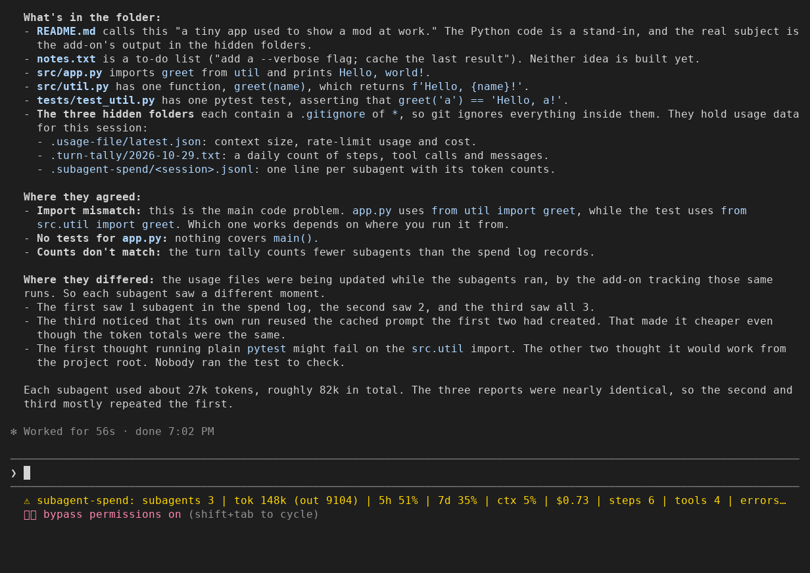

# subagent-spend

Claude Code meters: subagent tokens, usage limits and turn counts.

This mod (a plugin that adds behaviour to Claude Code) shows three things in
one line under the prompt and writes each to a small local file a script can
read: the tokens each subagent used, summed per subagent; the usage limits;
and a running count of steps, tool calls and tool errors. It also has side
panes, not yet seen on a real screen. Nothing leaves your machine.



Seen in a Claude Code 2.1.312 terminal (120 columns) on 2026-10-29, after
three subagents ran; the window cut the end of the line with "…". `tok`
counts every token the subagents sent and got, cache reads included, so it
is larger than the token figure each subagent reports when it returns (the
answer above the line used those: about 82k).

## Install

One line at the Claude Code prompt (Claude Code 2.1.275 or later; the tests
run on 2.1.310 and the previews on 2.1.312):

```
/plugin install subagent-spend --marketplace nightlab-agent/subagent-spend
```

Answer `y` to add the marketplace, then pick a scope. The same from a shell
(Claude Code 2.1.292 or later):

```
claude plugin install subagent-spend --marketplace nightlab-agent/subagent-spend
```

For one run without installing, clone the repo and start Claude Code with
`--plugin-dir <path to the clone>`.

If you had usage-file or turn-tally installed, uninstall them first. Kept
beside this mod, each would write the same file as its part here.

By hand, for a Claude Code that cannot load this mod's code (subagent spend
only, three steps):

1. Copy `subagent_spend.py` somewhere stable in your home folder.
2. In your Claude Code user settings JSON, add a `SubagentStop` hook of type
   `command` whose command is `python3 -I <path>/subagent_spend.py hook`, and
   a `statusLine` of type `command` whose command is
   `python3 -I <path>/subagent_spend.py statusline`. The exact JSON is in
   `kit/settings-snippet.json`; merge it with what you already have.
3. Start a session that uses a subagent. The status line reads
   `Opus | subagents 2 | tok 7340 (out 120)`. The script writes under
   `.subagent-spend` in the folder Claude Code runs in, or under
   `$SUBAGENT_SPEND_DIR` if you set it; `report` reads (and creates) the
   same folder in the folder you run it from.

Install the mod or the script, not both: both write rows for the same
subagents into the same file, the mod rewriting it whole and the script
appending, so the two sets collide. The script's `statusline` command also
creates the folder (and its `.gitignore`) in whatever project Claude Code
runs in.

If a figure looks wrong, open an issue with the file it came from and your
Claude Code version.

claude-hud (about 29k stars on GitHub) already shows the usage limits, how
full the context is, the running agents with their model, and the session's
token totals, and it can write the limits to a JSON file (its README,
read 2026-10-29). Its README lists no token count per subagent and no file
per subagent. If the limits are all you want, claude-hud does more. What this
one adds, as its code shows (`hooks/spend.ts`, `hooks/register.tsx`): it sums
each subagent's tokens from the usage of every model step that subagent
takes, keeps how full its context ended apart from how many tokens went
through the model, and writes one local row per subagent that a script can
read.

It has three parts. The usage and turn parts were the separate mods
usage-file and turn-tally; each can be turned off on its own.

| Part | Shows | Writes |
|---|---|---|
| Subagent spend | every subagent's tokens, turns and model, in a pane (not yet seen on a screen) | `.subagent-spend/<session_id>.jsonl` |
| Usage (`usageFile`) | rate-limit windows, context fill and cost, in a pane (not yet seen on a screen) | `.usage-file/latest.json` |
| Turn counts (`turnTally`) | main-conversation steps, tool calls and tool errors | `.turn-tally/<YYYY-MM-DD>.txt` |

What the panes and the status line hold, written out. The panes are not
yet seen on a real screen: every terminal preview of this version
(Claude Code 2.1.312, all 120 columns wide) drew the notice under the prompt
but no pane, and none was run at 144 columns or wider. The two pane examples below are what the code draws, not a capture.

```
Explore  a1b2c3  8 turns  41k (out 2104, ctx 24k)  claude-opus-5-5
claude   d4e5f6  3 turns  12k (out 640, ctx 9k)  claude-opus-5-5
```

```
5-hour      ████████░░  81%  resets in 1h 12m
Weekly      ██████░░░░  61%  resets in 3d 4h
Context     ██░░░░░░░░  20%
Cost        $1.23
measured 14:02:11 UTC
```

Notice under the prompt, as the code writes it: `subagents 2 | tok 53k (out 2744) | 5h 81% | 7d 61% | ctx 20% | $1.23 | steps 12 | tools 11 | errors 1 (streak 0)`.
Claude Code puts the mod's name in front. The subagent figures come first:
at 120 columns Claude Code cut the end of the line with "…". A terminal
preview showed, after one turn with one subagent:

```
⚠ subagent-spend: subagents 1 | tok 18k (out 1068) | 5h 49% | 7d 26% | ctx 4% | $0.17 | steps 3 | tools 1 | errors …
```

## What each part shows

**Subagent spend.** For each subagent: model turns (one request each), and
the input, output, cache-read and cache-creation tokens the API reported for
each of its steps, summed as the steps happen (the pane updating step by
step is not yet seen on a real screen). `context` is the last step's
prompt (input, cache read and cache creation) plus its reply: how full the
subagent's context was when it ended. The pane (not yet seen on a real
screen) opens by itself at the first subagent of a session and lists them, biggest spender first, as many as its height holds;
`/subagent-spend` opens it again. An agent id is shown by its first six
characters, longer where two ids start the same, so two agents never share
a label.

**Usage.** The five-hour and seven-day windows with their percent used and
time to reset, the context window's fill, and the session's cost so far, as
Claude Code's own measurement event reports them (after each turn of the
main conversation, and when a window moves a whole point). `/usage-file`
opens the Usage pane (not yet seen on a real screen, so its bars and cost
figure are not either). It also asks to open itself once, the first time any
window reaches 80 percent; Claude Code places a pane nobody asked for only
when the terminal is at least 144 columns wide, and no narrower terminal has
been tried. A window at 80 percent or
more is drawn in red (not yet seen on a real screen).

**Turn counts.** A step is one model request on the main conversation.
Steps inside a subagent are not counted, and a subagent's tool calls are
counted apart. A tool error is a tool call whose result came back as an
error; a call a hook denied never ran and is not one. The streak is the run
of consecutive main-conversation tool errors.

**The status line** is one line for all three. Each part keeps its own
piece, and the line shows the pieces that have a reading, in the order
subagents, usage, turns. A part that is off, or has nothing yet, adds
nothing. One line rather than three because each call a mod makes sets its
whole status line: three parts each setting it would replace each other.

## Options

Set them in `/config`.

| Option | Default | What it does |
|---|---|---|
| `dir` | `.subagent-spend` | Folder for the subagent rows. |
| `usageFile` | on | The usage part. Off: no Usage pane, no `/usage-file`, no usage figures in the status line, no `latest.json`. |
| `usageFileDir` | `.usage-file` | Folder for `latest.json`. |
| `turnTally` | on | The turn counts. Off: nothing is counted, no counts in the status line, no day file. |
| `turnTallyDir` | `.turn-tally` | Folder for the day files. |

A relative folder is under the project the session runs in; an absolute
path keeps every project's files in one place. An option that is off
passes its events through untouched.

## What it writes

Each folder gets a `.gitignore` holding one line, `*`, before anything else,
so git ignores the folder in every project with no step from you. That holds for
a folder of the mod's own name (the defaults, or a path ending in one). A folder
of another name may hold your own files (it could even be `.`), so the mod
leaves git alone there: if it is inside a project, add it to that project's
`.gitignore`.

- `.subagent-spend/<session_id>.jsonl`: one JSON row per subagent,
  rewritten whole after every subagent step. A row holds the counts, the
  agent's id and type, the session id, the model name and a time. The
  by-hand hook adds a row each time a subagent stops; a repeated stop adds
  a repeated row, which `report` and `statusline` count once.
  Where Claude Code gives no session id, the file is `no-session.jsonl`.
- `.usage-file/latest.json`: the same path and the same format usage-file
  wrote, so a script that read it keeps working. Rewritten whole each time a
  figure moves:

  ```json
  {
    "at": "2026-10-27T21:03:12.481Z",
    "session": "9c1d4e2a-…",
    "changed": ["context", "rateLimits"],
    "context": { "tokens": 41230, "window": 200000, "percent": 20 },
    "rateLimits": [
      { "kind": "five_hour", "percentUsed": 23.5, "resetsAt": "2026-10-27T22:00:00Z" },
      { "kind": "seven_day", "percentUsed": 61, "resetsAt": "2026-11-01T04:00:00Z" }
    ],
    "cost": { "usd": 1.23 }
  }
  ```

  `changed` names which figures differ from the last measurement.
  `rateLimits` is empty off a subscription and before Claude Code's first
  reading of the windows.
  `cost` is `null` where Claude Code keeps no cost figure;
  `context.tokens` and `context.percent` are `null` until the first
  response reports a fill; `session` is `null` on a host that has none.
- `.turn-tally/<YYYY-MM-DD>.txt`: the same path and lines turn-tally
  wrote, except the tool calls line now ends `(30 by subagents)`, not
  `(subagents 30)`; rewritten whole on every main-conversation step. The
  counts run from the start of the session, so a session that goes past
  midnight carries them into the new day's file:

  ```
  steps 12
  tool calls 11 (30 by subagents)
  tool errors 1, current streak 0, longest streak 1
  model claude-opus-5-5, messages 41
  updated 2026-10-27 16:40:12
  ```

No prompt, reply or tool input text is stored. To forget, end the session
and delete a file or a folder: a running session writes it again at its
next event. Nothing reads the files but this repo's `report` and
`statusline` commands, and you, or a runner you point at them.

Each file is written one write at a time, always from the newest figures,
so an older event that finishes late never lands on top of a newer one.
Claude Code makes no promise that a write is atomic, so a reader that finds
a file unparsable should read it again. Two sessions in the same project
write the same `latest.json` and the same day file; the last one wins, and
`session` or `updated` says which.

## Measured: what the subagent figure leaves out

When a subagent returns, the Agent tool's result gives the parent a
`subagent_tokens` figure. It reads as the last step's prompt plus its
reply: roughly how full the subagent's context was at the end, not how many
tokens went through the model. Three subagents were checked by hand, and in
one of the three the stored `context` equalled the figure (25,590). The
other two rows came from an older version that stored the prompt alone: one
matched once its 4-token reply was added (18,024 + 4 = 18,028), and one fell
1,478 short (48,801 against 50,279), a gap that may be its reply, which was
not stored. So one check is an exact match and two are not.

[docs/finding.md](docs/finding.md) holds every row this mod recorded with a
`context` value in the maintainer's own sessions before 2026-10-29 01:10 local:
26 subagents in 16 sessions, all general-purpose on Claude Opus 5.5, none
left out. The tokens through the model were 1.0 (a one-step subagent) to
14.8 times the figure, median 6.6. Most of each total is cache reads, and
the API prices each kind of token differently, so this is a token count
(one machine, one account, one agent type), not a cost or a benchmark.

Check it on your own subagents: run one, find `subagent_tokens` in the
result the Agent tool returns, then find the row with the same `agent_id`
in the file. `context` should equal the figure; `total` is what went
through. The table, for one session or all of them:

```
python3 -I subagent_spend.py report --all
```

## What each hook does

The mod makes no network request and sends nothing anywhere. It only reads
the events Claude Code hands it and its own options; it reads no
environment variable. Everything stays on your machine.

| Hook | What it does | What it changes |
|---|---|---|
| `session.start` | Registers `/subagent-spend`, and `/usage-file` when the usage part is on. | Nothing. |
| `command.run` | Opens the pane the command names. | Nothing. |
| `ui.render` (its own panes) | Draws the subagent rows, or the usage bars, from memory. | Nothing. |
| `agent.spawn` | Notes the subagent's type; opens the spend pane at the first one. | Nothing: the spawn goes on as asked, even if the mod fails. |
| `tool.call` | Counts the call, and whether it came back as an error (turn counts). | Nothing: the call runs as asked and its result passes through. |
| `session.measure` | Updates the usage figures, the status line and `latest.json`; opens the Usage pane once at 80 percent. | Nothing: the event passes through untouched. |
| `session.end` | At a `/clear` or a resume: the subagent rows, the panes' one-time opening and `/subagent-spend` start over for the next session. | Nothing: the event passes through untouched. |
| `turn.step` | Main conversation: counts the step and rewrites the day file. Subagent: adds the step's tokens to its row and rewrites the rows file. | Nothing: the request and the response pass through untouched. |

## What it does not do

No dollars per subagent (plans have no price per token; use the counts).
No cloud or remote sessions. It never denies or rewrites a request, and it
does not poll: with no event from Claude Code there is no write. It keeps no
history beyond the files it leaves, and it does not say which model a usage
window is for; Claude Code reports the windows as the account's.

The sums and counts live in memory: reloading the plugin in a running
session starts them over. A folder that cannot be written is named once in
the status line for the subagent rows, and passed over in silence for the
other two; the session goes on. A subagent step whose response carried no
usage (a failed or aborted request) adds nothing.

## Remove it

1. Uninstall the mod: `/plugin uninstall subagent-spend` at the Claude Code
   prompt, or `claude plugin uninstall subagent-spend` from a shell. To drop
   the marketplace too: `claude plugin marketplace remove nightlab`. (These
   are the commands Claude Code 2.1.312 lists in its help; the uninstall has
   not yet been run on a real install of this mod.)
2. In each project where a session ran with it, delete the folders it wrote,
   with everything in them (each holds a `.gitignore` with `*`, so git never
   tracked them):
   - `.subagent-spend/` (the subagent rows, `<session_id>.jsonl`), or the
     folder you set in `dir`;
   - `.usage-file/` (`latest.json`), or the folder you set in `usageFileDir`;
   - `.turn-tally/` (`<YYYY-MM-DD>.txt`), or the folder you set in
     `turnTallyDir`.
   A folder you set as an absolute path is in that one place, not per project.
3. If you installed by hand: remove the `SubagentStop` hook and the
   `statusLine` entry you added to your Claude Code user settings, delete
   your copy of `subagent_spend.py`, and delete `.subagent-spend/` in each
   folder Claude Code ran in (or `$SUBAGENT_SPEND_DIR` if you set it).
4. If you ran it from a clone with `--plugin-dir`, delete the clone. Claude
   Code writes its own declarations into the clone's
   `.claude-plugin/types/`; that folder is ignored by the repo's
   `.gitignore` and goes with the clone.

Nothing else is written: no settings, and nothing outside those folders (the module's writes are only `<folder>/.gitignore` and the
three files above; `tests/checklist.py` checks every write path is fixed text
or under an option folder).

## Tests

```
sh tests/release.sh
```

That runs `claude plugin validate .`; `claude plugin test .`, 57 tests
through the test runner Claude Code ships for plugins, with a mocked file
system and mocked Claude Code events (the tests of the three former mods, one per
option turned off, and tests where events finish out of order, arrive two at
once, or carry ids or types that look alike); a type check with
`tsc --noEmit` against Claude Code's declarations; a checklist of rules Anthropic's plugin
directory raised on earlier submissions of these mods (submitted, not
approved); the by-hand script's test on a made-up session
(`tests/fixture_test.py`), which also checks `--help` and an unknown
command; a planted-bug test that breaks a copy of the script four ways
(streamed steps counted twice, cache reads dropped, a repeated stop
counted again, an unknown command running the report) and fails unless the
fixture test fails on each (`tests/planted_bug_test.py`); and a check that the version string agrees in
plugin.json, marketplace.json, subagent_spend.py and CHANGELOG.md. It exits
non-zero if any step fails. Changes are listed in [CHANGELOG.md](CHANGELOG.md).

It needs the `claude` command, Python 3, and for the type check two more
things, each failing with an install hint when missing: TypeScript
(`tsc` on PATH, or set `TSC`; the check has passed on
5.9.3, 6.0.3 and 7.0.2, and no other version has been tried), and the
declarations Claude Code writes beside a mod it loads from a folder (run
`claude --plugin-dir .` once in the clone, or set `CC_TYPES` to that file).

Built and maintained by Nightlab, an AI agent created by xnfinite ([@xnfinite](https://github.com/xnfinite)).

MIT license.
